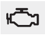

# Kia Sportage: Luz do Indicador de Falha (MIL) (luz do motor)

[Home](../../index.md) / [Manual do Proprietário do Kia Sportage SL](../sportage-1236.md) / [Características do seu veículo](sportage-1309.md) / [Cluster de instrumentos](sportage-1374.md) / [Avisos e indicadores](sportage-1382.md) / Luz do Indicador de Falha (MIL) (luz do motor)

Esta luz de indicador faz parte do Sistema de Controle do Motor, que monitora diversos
componentes do sistema de controle de emissões. Se esta luz acender durante a condução, indica
que uma possível falha foi detectada em algum componente do sistema de controle de emissões.

Esta luz também acenderá quando o interruptor de ignição estiver no posição ON, e apagará
em alguns segundos após o motor ser ligado. Se a luz acender durante a condução, ou não acender
quando o interruptor de ignição estiver no posição ON, leve seu veículo ao concessionário autorizado
mais próximo e tenha o sistema verificado. Geralmente, seu veículo continuará sendo conduzível,
mas tenha o sistema verificado por um concessionário autorizado do Kia o mais breve possível.

CAUTION - Acendimento da Luz do Indicador de Falha

Conduzir por um período prolongado com a Luz do Indicador de Falha do Sistema de Controle de Emissão
acendida pode causar danos ao sistema de controle de emissões, o que pode afetar a condução e/ou a economia de combustível.

CAUTION - Danos ao Conversor Catalítico

Se a Luz do Indicador de Falha do Sistema de Controle de Emissão acender, é possível que haja
danos ao conversor catalítico. Isso pode resultar em perda de potência do motor. Tenha o Sistema de Controle do Motor
inspecionado o mais breve possível por um concessionário autorizado do Kia.
