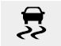

# Kia Sportage: Indicador de ESC (Electronic Stability Control)

[Início](../../index.md) / [Manual do proprietário do Kia Sportage SL](../sportage-1236.md) / [Características do seu veículo](sportage-1309.md) / [Cluster de instrumentos](sportage-1374.md) / [Avisos e indicadores](sportage-1382.md) / Indicador de ESC (Electronic Stability Control)

O indicador de ESC iluminará quando a chave do ignição estiver ligada, mas
deverá apagar-se aproximadamente após 3 segundos. Quando o ESC estiver ativo, ele monitorará as condições de direção e, em condições normais de direção, o indicador de ESC permanecerá desligado. Quando uma condição escorregadia ou de baixa tração for encontrada, o ESC operará, e o indicador de ESC piscará para indicar que o ESC está em operação.

Se este indicador iluminar e permanecer ligado, o ESC pode ter apresentado uma falha. Leve seu veículo a um concessionário autorizado da Kia e tenha o sistema verificado.
