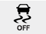

# Kia Sportage: Indicador ESC OFF

[Início](../../index.md) / [Manual do Proprietário do Kia Sportage SL](../sportage-1236.md) / [Características do seu veículo](sportage-1309.md) / [Cluster de instrumentos](sportage-1374.md) / [Avisos e indicadores](sportage-1382.md) / Indicador ESC OFF

O indicador ESC OFF iluminará quando a chave de ignição for ligada, mas deve apagar-se após aproximadamente 3 segundos. Para alternar para o modo ESC OFF, pressione o botão ESC OFF. O indicador ESC OFF iluminará, indicando que o ESC foi desativado.
