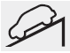

# Kia Sportage: Indicador DBC (Downhill brake control)

[Home](../../index.md) / [Manual do proprietário do Kia Sportage SL](../sportage-1236.md) / [Características do seu veículo](sportage-1309.md) / [Cluster de instrumentos](sportage-1374.md) / [Avisos e indicadores](sportage-1382.md) / Indicador DBC (Downhill brake control)

O indicador DBC iluminará quando o botão DBC for pressionado e o sistema estiver ativo.

Ao descer uma encosta íngreme a uma velocidade inferior a 35 km/h (22 mph), o DBC funcionará e o indicador DBC piscará para indicar que o DBC está em operação.

Caso o indicador vermelho ilumine, o sistema DBC pode ter apresentado um problema. Leve seu veículo a um concessionário autorizado da Kia e faça o check no sistema.
