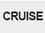
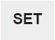

# Kia Sportage: Indicadores de cruzeiro

[Home](../../index.md) / [Manual do proprietário do Kia Sportage SL](../sportage-1236.md) / [Características do seu veículo](sportage-1309.md) / [Cluster de instrumentos](sportage-1374.md) / [Avisos e indicadores](sportage-1382.md) / Indicadores de cruzeiro

**INDICADOR DE CRUZEIRO**

O indicador acende quando o sistema de controle de cruzeiro estiver ativado. O indicador de cruzeiro no cluster de instrumentos acende quando a alavanca de ligar/desligar do controle de cruzeiro no volante for pressionada.

O indicador apaga quando a alavanca de ligar/desligar do controle de cruzeiro for pressionada novamente. Para mais informações sobre o uso do controle de cruzeiro, consulte "Sistema de controle de cruzeiro" na seção 5.

**Indicador SET de cruzeiro**

O indicador acende quando a alavanca de função de cruzeiro (SET - ou RES +) estiver ligada.

O indicador SET de cruzeiro no cluster de instrumentos acende quando a alavanca de controle de cruzeiro (SET - ou RES +) for pressionada.

O indicador SET de cruzeiro não acende quando a alavanca de controle de cruzeiro (CANCEL) for pressionada ou o sistema for desativado.
