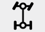

# Kia Sportage: Luz de advertência do sistema 4WD

[Home](../../index.md) / [Manual do proprietário do Kia Sportage SL](../sportage-1236.md) / [Características do seu veículo](sportage-1309.md) / [Cluster de instrumentos](sportage-1374.md) / [Advertências e indicadores](sportage-1382.md) / Luz de advertência do sistema 4WD

Quando a chave de ignição estiver no位置
assistant
Quando a chave de ignição estiver na posição ON, a luz do indicador 4WD iluminará e desligará em alguns segundos.

Se a luz de advertência do sistema 4WD iluminar, isso indica que há uma falha no sistema 4WD. Se isso ocorrer, leve seu veículo a um concessionário autorizado da Kia o mais rápido possível para ser verificado.
