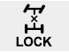

# Kia Sportage: Indicador 4WD LOCK

[Início](../../index.md) / [Manual do proprietário Kia Sportage SL](../sportage-1236.md) / [Características do seu veículo](sportage-1309.md) / [Cluster de instrumentos](sportage-1374.md) / [Avisos e indicadores](sportage-1382.md) / Indicador 4WD LOCK

O indicador 4WD LOCK é acionado quando o botão 4WD LOCK é pressionado. O modo 4WD LOCK tem como objetivo aumentar o poder de tração ao percorrer em pavimentação molhada, estradas nevadas e/ou fora de estrada. O indicador 4WD LOCK é desligado pressionando o botão novamente.

CAUTION - Modo 4WD LOCK

*Não use o modo 4WD LOCK em estradas secas ou rodovias, pois isso pode causar ruído, vibração ou danos às partes relacionadas ao 4WD.*
