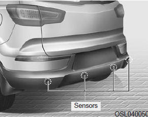

# Kia Sportage: Sistema de Alerta de Ré

[Início](../../index.md) / [Manual do Proprietário do Kia Sportage SL](../sportage-1236.md) / [Características do seu veículo](sportage-1309.md) / Sistema de Alerta de Ré

O Sistema de Alerta de Ré auxilia o condutor durante o movimento em ré do veículo, emitiu um som se algum objeto for detectado a uma distância de 120 cm (47 polegadas) atrás do veículo.

Este sistema é um sistema suplementar e não substitui a necessidade de cuidado extremo e atenção do condutor. O intervalo de detecção e os objetos detectáveis pelos sensores são limitados. Sempre que estiver em ré, preste a mesma atenção ao que está atrás do que faria em um veículo sem o Sistema de Alerta de Ré.

AVISO

*O Sistema de Alerta de Ré é uma função suplementar apenas. A operação do Sistema de Alerta de Ré pode ser afetada por vários fatores (incluindo condições ambientais). É a responsabilidade do condutor sempre verificar a área atrás do veículo antes e durante o movimento em ré.*

AVISO - Sistema de Alerta de Ré

*Nunca confie exclusivamente no sistema de assistência de estacionamento ao realizar o movimento em ré. Sempre realize uma inspeção visual para garantir que o veículo esteja livre de todas as obstruções antes de mover o veículo em qualquer direção. Pare imediatamente se souber que há um criança em qualquer lugar perto do seu veículo. Alguns objetos podem não ser detectados pelos sensores devido ao tamanho ou ao material do objeto.*

- [Operação do Sistema de Alerta de Ré](sportage-1412.md)
- [Condições não operacionais do Sistema de Alerta de Ré](sportage-1413.md)
- [Precauções do Sistema de Alerta de Ré](sportage-1414.md)
- [Diagnóstico Self](sportage-1415.md)
