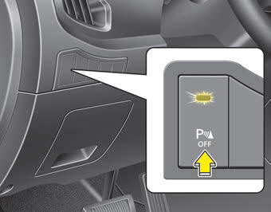

# Kia Sportage: Operação do sistema de alerta de ré

[Home](../../index.md) / [Manual do proprietário Kia Sportage SL](../sportage-1236.md) / [Características do seu veículo](sportage-1309.md) / [Sistema de alerta de ré](sportage-1411.md) / Operação do sistema de alerta de ré

**Condições de operação**

- Este sistema será ativado quando o veículo estiver em ré com o interruptor de ignição ligado.
- Se o veículo estiver em movimento a uma velocidade superior a 10 km/h (6 mph), o sistema pode não ser ativado corretamente.
- Este sistema será ativado quando a luz no botão de desativação do assistente de estacionamento traseiro não estiver iluminada. Se desejar desativar o sistema de alerta de ré, pressione o botão de desativação do assistente de estacionamento traseiro. (A luz no botão iluminará.) Para ligar o sistema, pressione o botão novamente. (A luz no botão apagará.)
- A distância de detecção enquanto o sistema de alerta de ré estiver em operação é aproximadamente 120 cm (47 in.).
- Quando mais de dois objetos forem detectados simultaneamente, o mais próximo será reconhecido primeiro.

**Tipos de som de alerta**

- Quando um objeto estiver a 120 cm a 81 cm (47 in. a 32 in.) do para-choques traseiro: O buzzer bipa intermitentemente.
- Quando um objeto estiver a 80 cm a 41 cm (31 in. a 16 in.) do para-choques traseiro: O buzzer bipa com mais frequência.
- Quando um objeto estiver a menos de 40 cm (15 in.) do para-choques traseiro: O buzzer soa continuamente.
