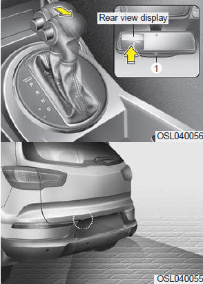

# Kia Sportage: Exibição da câmera traseira

[Home](../../index.md) / [Manual do proprietário Kia Sportage SL](../sportage-1236.md) / [Características do seu veículo](sportage-1309.md) / Exibição da câmera traseira

A exibição da câmera traseira será ativada quando a luz de ré estiver ligada com o interruptor de ignição ligado e a alavanca de câmbio em posição R (Ré).

Este sistema é um sistema suplementar que exibe o que está atrás do veículo através do espelho retrovisor de exibição enquanto estiver em ré.

A exibição da câmera traseira pode ser desligada pressionando o botão ON/OFF (1) quando a exibição da câmera traseira estiver ativada.

Para ligar a câmera novamente, pressione o botão ON/OFF novamente quando o interruptor de ignição estiver ligado e a alavanca de câmbio em R (Ré). Também, a câmera ligará automaticamente sempre que o interruptor de ignição for desligado e ligado novamente.

Nunca confie exclusivamente na exibição da câmera traseira ao estacionar.

- A exibição da câmera traseira e o sistema de advertência de ré não substituem as procedimentos de estacionamento corretos e seguros. Sempre dirija com segurança e use cautela ao estacionar. A exibição da câmera traseira e o sistema de advertência de ré podem não detectar todos os objetos atrás do veículo.
- Sempre mantenha o lente da câmera limpo. Se o lente estiver coberto por material estranho, a câmera pode não funcionar normalmente.

Informações detalhadas sobre a exibição da câmera traseira no sistema de navegação estão descritas em um manual separadamente fornecido.
