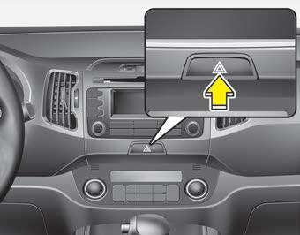

# Kia Sportage: Farol de advertência de perigo

[Início](../../index.md) / [Manual do proprietário do Kia Sportage SL](../sportage-1236.md) / [Características do seu veículo](sportage-1309.md) / Farol de advertência de perigo

O farol de advertência de perigo deve ser usado sempre que for necessário parar
o veículo em uma localização perigosa. Quando você precisar fazer um tal parada
emergencial, sempre se afaste o máximo possível da estrada.

Os faróis de advertência são ligados pressionando o interruptor de advertência. Ambos
os faróis de sinalização de direção piscarão. Os faróis de advertência funcionarão mesmo
que a chave não esteja no interruptor de ignição.

Para desligar os faróis de advertência, pressione o interruptor novamente.

AVISO - Ré e uso da câmera

*Nunca se baseie exclusivamente na câmera de ré para ré. Você deve sempre usar
métodos de visualização da área atrás de você, incluindo olhar para ambos os ombros e
verificando continuamente todos os três faróis de ré. Devido à dificuldade de garantir
que a área atrás de você permaneça clara, sempre ré lentamente e pare imediatamente
se você suspeitar, e especialmente se um criança, estiver atrás de você.*
