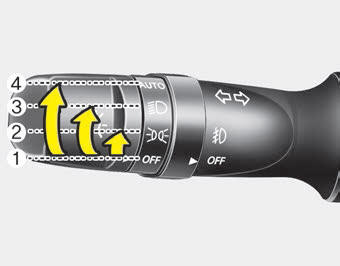

# Kia Sportage: Controle de iluminação

[Início](../../index.md) / [Manual do proprietário do Kia Sportage SL](../sportage-1236.md) / [Características do seu veículo](sportage-1309.md) / [Iluminação](sportage-1418.md) / Controle de iluminação

O interruptor de iluminação tem as posições Frente e Freio. Para operar as luzes, girar o botão no final do lembrete de controle para uma das seguintes posições:

(1) Posição OFF

(2) Posição de luz de freio

(3) Posição de luz de frente

(4) Posição de luz automática (se equipado)

- [Posição de luz de freio](sportage-1423.md)
- [Posição de luz de frente](sportage-1424.md)
- [Posição de luz automática](sportage-1425.md)
