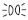
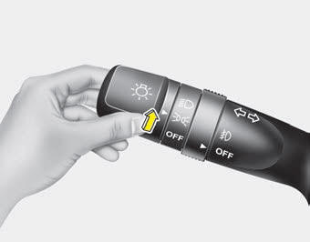

# Kia Sportage: Posição das luzes de estacionamento

[Home](../../index.md) / [Manual do proprietário do Kia Sportage SL](../sportage-1236.md) / [Características do seu veículo](sportage-1309.md) / [Iluminação](sportage-1418.md) / [Controle da iluminação](sportage-1422.md) / Posição das luzes de estacionamento

Quando o interruptor de luz estiver na posição de luz de estacionamento (1ª posição), as luzes traseiras, de placa e de painel de instrumentos se acenderão.
