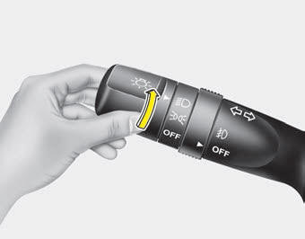

# Kia Sportage: Posição dos faróis

[Home](../../index.md) / [Manual do proprietário do Kia Sportage SL](../sportage-1236.md) / [Características do seu veículo](sportage-1309.md) / [Iluminação](sportage-1418.md) / [Controle da iluminação](sportage-1422.md) / Posição dos faróis

Quando o interruptor de luz estiver na posição dos faróis (2ª posição), os faróis, os faros traseiros, a luz do número de placa e a iluminação do painel de instrumentos serão ligados.

O interruptor de ignição deve estar na posição ON para ligar os faróis.
