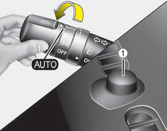

# Kia Sportage: Posição da luz automática

[Início](../../index.md) / [Manual do proprietário do Kia Sportage SL](../sportage-1236.md) / [Características do seu veículo](sportage-1309.md) / [Iluminação](sportage-1418.md) / [Controle da iluminação](sportage-1422.md) / Posição da luz automática

Quando o interruptor de luz estiver na posição AUTO, as luzes de ré e as luzes de cabeça ligarão automaticamente dependendo da quantidade de luz no exterior do veículo.

- Nunca coloque nada sobre o sensor (1) localizado no painel de instrumentos. Isso assegurará um controle melhor do sistema de luz automática.
- Não limpe o sensor com limpador de vidros. O limpador pode deixar uma película de luz que pode interferir no funcionamento do sensor.
- Se o seu veículo tiver adesivo de vidro escuro ou outro tipo de revestimento metálico na janela frontal, o sistema de luz automática pode não funcionar corretamente.
