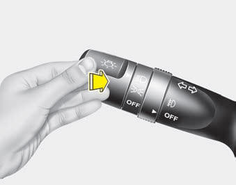
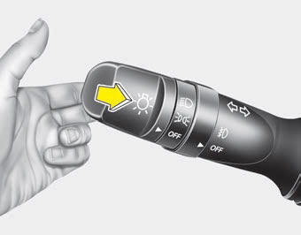

# Kia Sportage: Operação do farol alto

[Início](../../index.md) / [Manual do proprietário do Kia Sportage SL](../sportage-1236.md) / [Características do seu veículo](sportage-1309.md) / [Iluminação](sportage-1418.md) / Operação do farol alto

Para ligar o farol alto, empurre o puxador para longe de você. Puxe-o de volta para os farol baixo.

O indicador de farol alto se acenderá quando os faróis de cabeça em alta se forem ligados.

Para evitar a descarga da bateria, não deixe os faróis ligados por um tempo prolongado enquanto o motor estiver desligado.

AVISO - Farol alto

*Não use farol alto quando há outros veículos. O uso de farol alto pode obstruir a visão do motorista do outro veículo.*

Para piscar os faróis, puxe o puxador para você. Ele retornará à posição normal (farol baixo) quando solto. O interruptor de farol não precisa estar ligado para usar esta função de piscar.
