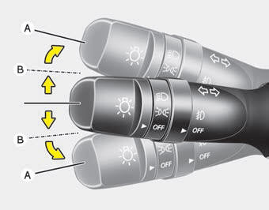

# Kia Sportage: Sinais de direção e de troca de faixa

[Home](../../index.md) / [Manual do Proprietário Kia Sportage SL](../sportage-1236.md) / [Características do seu veículo](sportage-1309.md) / [Iluminação](sportage-1418.md) / Sinais de direção e de troca de faixa

O interruptor de ignição deve estar ligado para que os sinais de direção funcionem. Para ligar os sinais de direção, mova o lembrete para cima ou para baixo (A). As setas verdes indicadoras na painel de instrumentos indicam qual sinal de direção está funcionando. Eles se auto-cancelarão após a conclusão da curva. Se o indicador continuar a piscar após uma curva, manualmente retorne o lembrete para a posição OFF.

Para indicar uma troca de faixa, mova o lembrete de sinal de direção levemente e mantenha-o na posição (B). O lembrete retornará para a posição OFF quando liberado.

Se um indicador permanecer ligado e não piscar ou piscar de forma anormal, uma das lâmpadas de sinal de direção pode estar queimada e precisará ser substituída.

**Função de troca de faixa com um toque**

Para ativar a função de troca de faixa com um toque, mova o lembrete de sinal de direção levemente por menos de 1,5 segundo e, em seguida, solte-o. Os sinais de troca de faixa piscarão 3 vezes.

*✽ NOTA*

*Se um piscar de indicador for anormalmente rápido ou lento, uma lâmpada pode estar queimada ou ter uma conexão elétrica fraca no circuito.*
