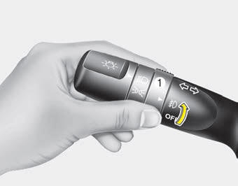

# Kia Sportage: Luz dianteira antifogos

[Home](../../index.md) / [Manual do proprietário Kia Sportage SL](../sportage-1236.md) / [Características do seu veículo](sportage-1309.md) / [Iluminação](sportage-1418.md) / Luz dianteira antifogos

As luzes antifogos são utilizadas para proporcionar melhor visibilidade quando a visibilidade é baixa devido a nevoeiro, chuva ou neve, entre outros. As luzes antifogos ligarão quando o interruptor de luz antifogos (1) for posicionado na posição ON após a iluminação das luzes de cabeça ter sido ativada.

Para desligar as luzes antifogos, posicione o interruptor de luz antifogos (1) na posição OFF.

Ao funcionar, as luzes antifogos consomem grande quantidade de energia elétrica do veículo. Utilize apenas as luzes antifogos quando a visibilidade for baixa.
