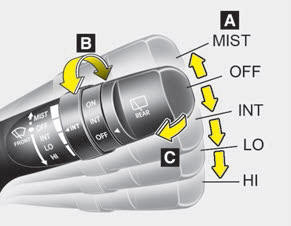

# Kia Sportage: Limpador e lavador de para-brisa

[Home](../../index.md) / [Manual do proprietário Kia Sportage SL](../sportage-1236.md) / [Características do seu veículo](sportage-1309.md) / [Limpadores e lavadores](sportage-1430.md) / Limpador e lavador de para-brisa

**A : Controle de velocidade do limpador**

· MIST – Limpador único

· OFF – Desligado

· INT – Limpador intermitente

AUTO* – Controle automático

· LO – Velocidade baixa do limpador

· HI – Velocidade alta do limpador

**B : Ajuste do tempo de limpeza intermitente**

**C : Lavagem com limpeza rápida (dianteira)**
