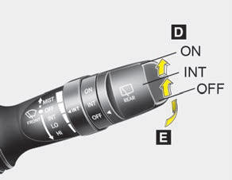

# Kia Sportage: Despejador de vidro traseiro

[Início](../../index.md) / [Manual do proprietário do Kia Sportage SL](../sportage-1236.md) / [Características do seu veículo](sportage-1309.md) / [Limpadores e lavadores](sportage-1430.md) / Despejador de vidro traseiro

**D : Controle do despejador traseiro**

· ON – Limpador contínuo

· INT* – Limpador intermitente

· OFF – Desligado

**E : Lavagem com limpeza breve (traseiro)**
