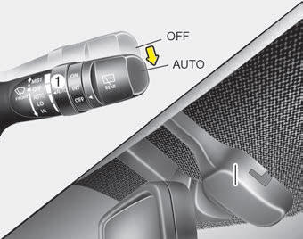

# Kia Sportage: Pára-chuvas da janela frontal

[Home](../../index.md) / [Manual do proprietário Kia Sportage SL](../sportage-1236.md) / [Características do seu veículo](sportage-1309.md) / [Pára-chuvas e lavadoras](sportage-1430.md) / Pára-chuvas da janela frontal

Operado conforme indicado quando o interruptor de ignição estiver ligado.

MIST : Para um único ciclo de limpeza, empurre o lembrete para cima e solte-o com o
lembrete na posição OFF. Os limpadores funcionarão continuamente se o lembrete
for empurrado para cima e mantido.

OFF : O limpador não está em operação

INT : O limpador opera intermitentemente com os mesmos intervalos de limpeza. Use este modo
em chuva leve ou neblina. Para variar a configuração de velocidade, gire o botão de controle de velocidade.

LO : Velocidade normal do limpador

HI : Velocidade rápida do limpador

Se houver uma acumulação significativa de neve ou gelo na janela, desfroste a janela por cerca de 10 minutos, ou até que a neve e/ou o gelo sejam removidos antes
de usar os limpadores para garantir a operação correta.

**Controle automático**

O sensor localizado no topo da janela de vidro detecta a quantidade de chuva e controla o ciclo de limpeza para o intervalo apropriado. Quanto mais chove, mais rápido o limpador opera. Quando a chuva para, o limpador para.

ATENÇÃO - Cobertura do sensor

*Não remova a cobertura do sensor localizada no topo do vidro do passageiro, pois isso pode danificar o sistema do sensor.*

ATENÇÃO - Direção no inverno

*Sempre configure o interruptor do limpador automático para a posição OFF no inverno para evitar
ativação automática durante condições de gelo, o que pode danificar os limpadores da janela.*

Para variar a configuração de velocidade, gire o botão de controle de velocidade (1).

Se o interruptor do limpador estiver configurado em modo AUTOMÁTICO quando o interruptor de ignição estiver ligado, o limpador operará uma vez para realizar uma verificação do sistema. Configure o limpador para a posição OFF quando o limpador não estiver em uso.

ATENÇÃO - Posição do limpador

*Quando lavar o veículo, configure o interruptor do limpador para a posição OFF para parar
a operação do limpador automático.*

*O limpador pode operar e ser danificado se o interruptor estiver configurado em modo AUTOMÁTICO
enquanto se lava o veículo.*
