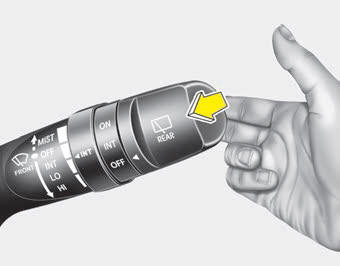

# Kia Sportage: Lavadores de Para-brisa Dianteiro

[Home](../../index.md) / [Manual do Proprietário do Kia Sportage SL](../sportage-1236.md) / [Características do seu veículo](sportage-1309.md) / [Limpadores e lavadores de para-brisa](sportage-1430.md) / Lavadores de para-brisa dianteiro

Na posição OFF, puxe suavemente o puxador para você para espalhar o líquido limpador na janela de vidro e para fazer as rodas girarem 1-3 ciclos.

Use esta função quando a janela de vidro estiver suja.

A operação do jato e das rodas continuará até que você solte o puxador.

Se o lavador não funcionar, verifique o nível do líquido do lavador. Se o nível de líquido não for suficiente, você precisará adicionar líquido limpador de para-brisa apropriado e não abrasivo ao reservatório do lavador.

O gargalo de enchimento do reservatório está localizado na frente do compartimento do motor, no lado do passageiro.

CAUTION - Bomba de lavador

*Para prevenir possíveis danos à bomba de lavador, não operar o lavador quando o reservatório de líquido estiver vazio.*

WARNING - Visibilidade obscurecida

*Não use o lavador em temperaturas de congelamento sem primeiro aquecer a janela de vidro com os desembaçadores; a solução do lavador poderia congelar na janela de vidro e obscurecer sua visão.*

CAUTION - Rodas e janelas de vidro

- *Para prevenir possíveis danos às rodas ou janelas de vidro, não operar
	as rodas quando a janela de vidro estiver seca.*
- *Para prevenir danos às lâminas das rodas, não use gasolina, kerosene,
	tintas à base de solvente ou outros solventes sobre ou perto delas.*
- *Para prevenir danos aos braços das rodas e a outros componentes, não tente
	mover as rodas manualmente.*
