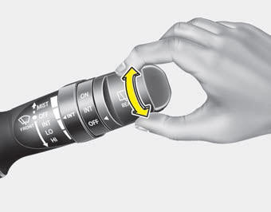
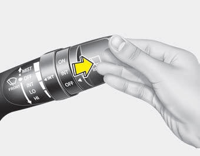

# Kia Sportage: Trocador de limpador e lavador de vidro traseiro

[Home](../../index.md) / [Manual do proprietário Kia Sportage SL](../sportage-1236.md) / [Características do seu veículo](sportage-1309.md) / [Limpadores e lavadores](sportage-1430.md) / Trocador de limpador e lavador de vidro traseiro

O trocador de limpador e lavador de vidro traseiro está localizado no final do
lembrete do limpador e lavador. Vire o interruptor para a posição desejada para
operar o limpador e lavador de vidro traseiro.

ON - Operação normal do limpador

INT - Operação intermitente do limpador (se equipado)

OFF - O limpador não está em operação

Empurre o lembrete para longe de você para sprayer o fluido de lavagem do vidro traseiro e para rodar os limpadores de vidro traseiro 1~3 ciclos. A operação de sprayer e limpador continuará até que você solte o lembrete.
