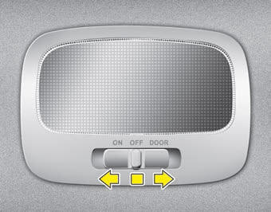

# Kia Sportage: Lampra Interna

[Início](../../index.md) / [Manual do proprietário do Kia Sportage SL](../sportage-1236.md) / [Características do seu veículo](sportage-1309.md) / [Luz interna](sportage-1436.md) / Lampra Interna

A luz ligará e desligará conforme o seguinte se o interruptor for movido.

• ON: A luz permanecerá ligada o tempo todo.

• OFF: A luz permanecerá desligada o tempo todo.

• PORTA: A luz acenderá quando qualquer porta for aberta, independentemente da posição do interruptor de ignição. Quando as portas são desbloqueadas pelo transmissor ou a chave é removida do interruptor de ignição, a luz acenderá por aproximadamente 30 segundos, desde que nenhuma porta seja aberta. A luz apagará gradualmente após aproximadamente 30 segundos se a porta for fechada.

No entanto, se o interruptor de ignição estiver ON ou todas as portas estiverem trancadas, a luz apagará imediatamente. Se uma porta for aberta com o interruptor de ignição na posição ACC ou LOCK, a luz permanecerá ligada por cerca de 20 minutos. No entanto, se uma porta for aberta com o interruptor de ignição na posição ON, a luz permanecerá ligada continuamente.
