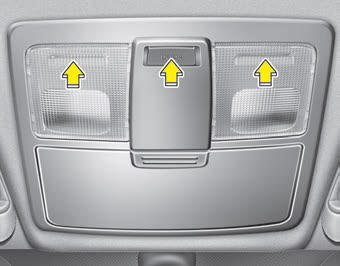

# Kia Sportage: Lampada do mapa

[Home](../../index.md) / [Manual do proprietário do Kia Sportage SL](../sportage-1236.md) / [Características do seu veículo](sportage-1309.md) / [Luzes internas](sportage-1436.md) / Lampada do mapa

A luz se acenderá e se apagará conforme abaixo se o botão for pressionado. A luz se apagará novamente se o botão for pressionado novamente.

• Pressione o vidro para acender ou apagar a lampada do mapa. Esta luz produz um feixe direto, facilitando o uso como lampada do mapa à noite ou como lampada pessoal para o condutor e o passageiro dianteiro.

• DOOR

A luz se acende quando qualquer porta é aberta ou o interruptor de ignição é desligado (se equipado).

A luz se apaga gradualmente após aproximadamente 30 segundos se a porta for fechada ou o interruptor de ignição for desligado.

No entanto, se todas as portas estiverem trancadas ou o interruptor de ignição estiver ligado, a luz se apagará imediatamente.
