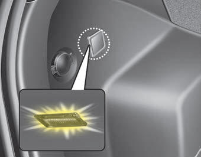

# Kia Sportage: Lampada do bagageiro

[Home](../../index.md) / [Manual do proprietário do Kia Sportage SL](../sportage-1236.md) / [Características do seu veículo](sportage-1309.md) / [Lâmpadas internas](sportage-1436.md) / Lampada do bagageiro

A lampada do bagageiro acende quando a porta traseira é aberta.
