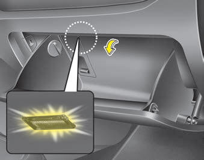

# Kia Sportage: Lampada do compartimento de ferramentas

[Home](../../index.md) / [Manual do proprietário do Kia Sportage SL](../sportage-1236.md) / [Características do seu veículo](sportage-1309.md) / [Luzes internas](sportage-1436.md) / Lampada do compartimento de ferramentas

A lampada do compartimento de ferramentas se acende quando o compartimento de ferramentas é aberto.

Os faróis de estacionamento ou os faróis principais devem estar ligados para que a lampada do compartimento de ferramentas funcione.
