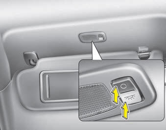
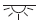

# Kia Sportage: Lampada do espelho vã

[Home](../../index.md) / [Manual do proprietário do Kia Sportage SL](../sportage-1236.md) / [Características do seu veículo](sportage-1309.md) / [Lâmpadas internas](sportage-1436.md) / Lampada do espelho vã

: A lâmpada ligará se este
botão for pressionado.

: A lâmpada desligará se este
botão for pressionado.

*✽ NOTA*

*Desligue a lâmpada antes de retornar o visor solar ao seu posicionamento original.*
