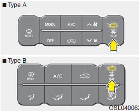

# Kia Sportage: Defletor de neblina traseira

[Home](../../index.md) / [Manual do proprietário do Kia Sportage SL](../sportage-1236.md) / [Características do seu veículo](sportage-1309.md) / [Defletor de neblina](sportage-1443.md) / Defletor de neblina traseira

O defletor de neblina aquece a janela para remover a neblina, a neve e a crosta de gelo fino da janela traseira, enquanto o motor está em funcionamento.

Para ativar o defletor de neblina traseira, pressione o botão do defletor de neblina traseira localizado no painel de interruptores central. O indicador no botão do defletor de neblina traseira se ilumina quando o defletor está ligado.

Se houver uma acumulação significativa de neve na janela traseira, escove-a antes de operar o defletor de neblina traseira.

O defletor de neblina traseira se desliga automaticamente após aproximadamente 20 minutos ou quando o interruptor de ignição é desligado. Para desligar o defletor, pressione o botão do defletor de neblina traseira novamente.

**Defletor de neblina do espelho retrovisor externo (se equipado)**

Se o seu veículo estiver equipado com os defletores de neblina do espelho retrovisor externo, eles funcionarão simultaneamente com o acionamento do defletor de neblina traseira.

**Descongelador de limpador de vidros (se equipado)**

Se o seu veículo estiver equipado com o descongelador de limpador de vidros, ele funcionará simultaneamente com o acionamento do defletor de neblina traseira.
