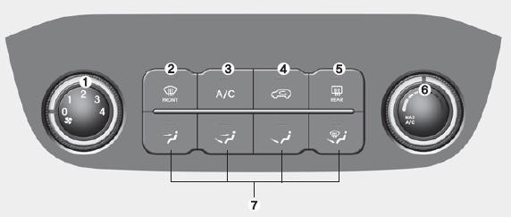

# Kia Sportage: Sistema de controle climático manual

[Início](../../index.md) / [Manual do proprietário do Kia Sportage SL](../sportage-1236.md) / [Características do seu veículo](sportage-1309.md) / Sistema de controle climático manual

1. Botão de controle da velocidade do ventilador

2. Botão de desnebulização do para-brisa frontal

3. Botão de ar condicionado (se equipado)

4. Botão de controle da entrada de ar

5. Botão de desnebulização da janela traseira

6. Botão de controle da temperatura

7. Botão de seleção de modo

- [Aquecimento e ar condicionado](sportage-1446.md)
- [Operação do sistema](sportage-1453.md)
- [Filtro de ar do controle climático](sportage-1457.md)
- [Verificação da quantidade de refrigerante do ar condicionado e lubrificante do compressor](sportage-1458.md)
