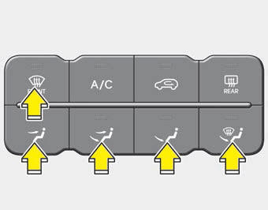
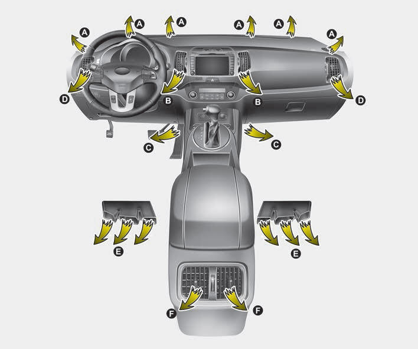
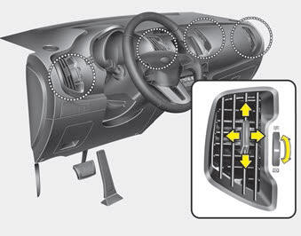

# Kia Sportage: Seleção de Modos

[Home](../../index.md) / [Manual do proprietário Kia Sportage SL](../sportage-1236.md) / [Características do seu veículo](sportage-1309.md) / [Sistema de controle climático manual](sportage-1445.md) / [Aquecimento e climatização](sportage-1446.md) / Seleção de modos

Os botões de seleção de modo controlam a direção do fluxo de ar pelo sistema de ventilação.

O ar pode ser direcionado para o chão, para os saídos no painel ou para o para-brisa. Cinco símbolos são usados para representar as posições de ar Face, Bi-Level, Floor, Floor-Defrost e Defrost.

**Face-Level (B, D, F\*)**

O fluxo de ar é direcionado para o corpo superior e para a face. Além disso, cada saída pode ser controlada para direcionar o ar emitido pela saída.

**Bi-Level (B, D, E, C, F\*)**

O fluxo de ar é direcionado para a face e para o chão.

**Floor-Level (C, E, A, D)**

A maior parte do fluxo de ar é direcionada para o chão, com uma pequena quantidade de ar sendo direcionada para o para-brisa e desentupidores das janelas laterais.

**Floor/Defrost-Level (A, C, D, E)**

A maior parte do fluxo de ar é direcionada para o chão e para o para-brisa, com uma pequena quantidade direcionada para os desentupidores das janelas laterais.

**Defrost-Level (A, D)**

A maior parte do fluxo de ar é direcionada para o para-brisa, com uma pequena quantidade de ar sendo direcionada para os desentupidores das janelas laterais.

**Saídas no painel**

As saídas podem ser abertas ou fechadas separadamente usando o roda-mãos. (Se equipado)

Também é possível ajustar a direção do fluxo de ar dessas saídas usando o controle de ventilação, conforme mostrado.
