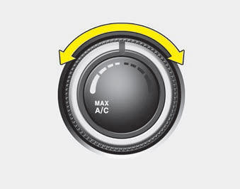
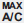

# Kia Sportage: Controle de Temperatura

[Home](../../index.md) / [Manual do Proprietário do Kia Sportage SL](../sportage-1236.md) / [Características do seu veículo](sportage-1309.md) / [Sistema de controle climático manual](sportage-1445.md) / [Aquecimento e climatização](sportage-1446.md) / Controle de Temperatura

O botão de controle de temperatura permite controlar a temperatura do ar que está sendo direcionado pelo sistema de ventilação. Para mudar a temperatura do ar no compartimento do passageiro, vire o botão para a posição direita para ar quente ou para a posição esquerda para ar mais frio.

Se você selecionar o

, o ar condicionado e a posição de ar recirculado serão selecionados automaticamente.
