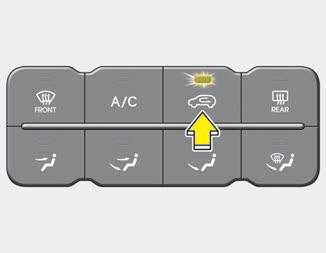
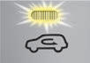
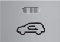

# Kia Sportage: Controle da entrada de ar

[Home](../../index.md) / [Manual do proprietário do Kia Sportage SL](../sportage-1236.md) / [Características do seu veículo](sportage-1309.md) / [Sistema de controle climático manual](sportage-1445.md) / [Aquecimento e climatização](sportage-1446.md) / Controle da entrada de ar

O controle da entrada de ar é usado para selecionar a posição de ar externo (ar fresco) ou ar recirculado.

Para mudar a posição do controle da entrada de ar, pressione o botão de controle.

**Posição de ar recirculado**

Com a posição de ar recirculado selecionada, o ar do compartimento do passageiro será aspirado pelo sistema de aquecimento e aquecido ou resfriado de acordo com a função selecionada.

**Posição de ar externo (ar fresco)**

Com a posição de ar externo (ar fresco) selecionada, o ar entra no veículo do exterior e é aquecido ou resfriado de acordo com a função selecionada.

O uso prolongado do aquecedor na posição de ar recirculado (sem ar condicionado selecionado) pode causar neblina no vidro e nas janelas laterais e o ar no compartimento do passageiro pode ficar pesado.

Além disso, o uso prolongado do ar condicionado na posição de ar recirculado resultará em ar muito seco no compartimento do passageiro.

AVISO - Redução da visibilidade

*O uso contínuo do sistema de controle climático na posição de ar recirculado pode permitir que a umidade aumente no veículo, o que pode causar neblina nos vidros e obscurecer a visibilidade.*

AVISO - Ar recirculado

*O uso contínuo do sistema de controle climático na posição de ar recirculado pode causar sonolência ou letargia, e perda do controle do veículo. Tente manter o controle da entrada de ar na posição de ar externo (ar fresco) o máximo possível ao dirigir.*
