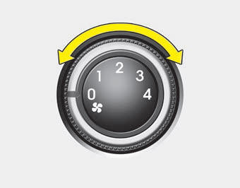

# Kia Sportage: Controle de Velocidade do Fan

[Início](../../index.md) / [Manual do proprietário do Kia Sportage SL](../sportage-1236.md) / [Características do seu veículo](sportage-1309.md) / [Sistema de controle climático manual](sportage-1445.md) / [Aquecimento e climatização](sportage-1446.md) / Controle de Velocidade do Fan

O interruptor de ignição deve estar na posição ON para o funcionamento do fan.

O botão de controle de velocidade do fan permite controlar a velocidade do fan do ar que flui do sistema de ventilação. Para alterar a velocidade do fan, vire o botão para a direita para aumentar a velocidade ou para a esquerda para diminuir a velocidade.

Definir o botão de controle de velocidade do fan na posição “0” desliga o fan.
