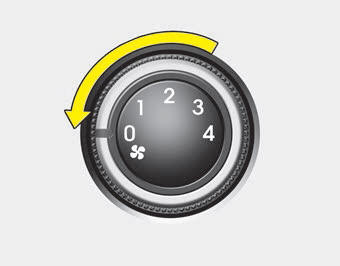

# Kia Sportage: Desligar os ventiladores

[Início](../../index.md) / [Manual do proprietário do Kia Sportage SL](../sportage-1236.md) / [Características do seu veículo](sportage-1309.md) / [Sistema de controle climático manual](sportage-1445.md) / [Aquecimento e climatização](sportage-1446.md) / Desligar os ventiladores

Para desligar os ventiladores, vire o botão de controle de velocidade do ventilador para a posição "0".
