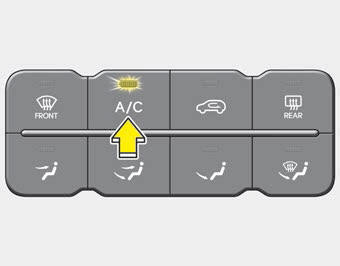

# Kia Sportage: Condicionador de Ar

[Início](../../index.md) / [Manual do Proprietário do Kia Sportage SL](../sportage-1236.md) / [Características do seu veículo](sportage-1309.md) / [Sistema de controle climático manual](sportage-1445.md) / [Aquecimento e condicionador de ar](sportage-1446.md) / Condicionador de Ar

Pressione o botão A/C para ligar o sistema de condicionador de ar (a luz indicadora
irá acender). Pressione o botão novamente para desligar o sistema de condicionador de ar.
