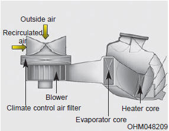

# Kia Sportage: Filtro de ar do controle climático

[Home](../../index.md) / [Manual do proprietário do Kia Sportage SL](../sportage-1236.md) / [Características do seu veículo](sportage-1309.md) / [Sistema de controle climático manual](sportage-1445.md) / Filtro de ar do controle climático

O filtro de ar do controle climático instalado atrás do porta-luvas filtra a poeira
ou outros poluentes que entram no veículo do exterior através do sistema de aquecimento
e ar condicionado. Se a poeira ou outros poluentes acumularem no filtro ao longo do tempo,
a circulação de ar dos ventiladores pode diminuir, resultando em formação de umidade
na parte interna do para-brisa mesmo quando a posição de ar fresco for selecionada. Se isso acontecer,
inspecione e substitua o filtro de ar do controle climático. (Consulte “filtro de ar do controle climático”
na seção 7.)

Se você estiver incerto sobre o procedimento de substituição, deixe que um concessionário autorizado
Kia faça isso.

*✽ NOTA*

- *Substitua o filtro de acordo com a Tabela de Manutenção. Se o veículo estiver sendo dirigido
	em condições severas, como estradas polvilhadas ou ruas irregulares, verificações e trocas mais frequentes
	dos filtros do ar condicionado são necessárias.*
- *Se a taxa de fluxo de ar diminuir de forma repentina, o sistema deve ser verificado
	em um concessionário autorizado Kia.*
