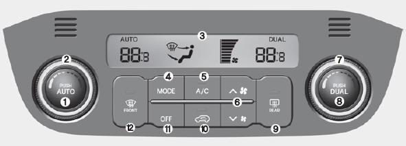

# Kia Sportage: Sistema de controle climático automático

[Início](../../index.md) / [Manual do proprietário do Kia Sportage SL](../sportage-1236.md) / [Características do seu veículo](sportage-1309.md) / Sistema de controle climático automático

1. Botão AUTO (controle automático)

2. Knob de controle de temperatura do motorista

3. Exibição do A/C

4. Botão de seleção de modo

5. Botão do ar condicionado*

6. Interruptor de controle de velocidade do ventilador

7. Knob de controle de temperatura do passageiro

8. Botão de seleção de temperatura dual

9. Botão do desentorpecimento do vidro traseiro

10. Botão de controle da entrada de ar

11. Botão OFF do ventilador

12. Botão de desentorpecimento do para-brisa frontal

- [Aquecimento e ar condicionado automáticos](sportage-1460.md)
- [Aquecimento e ar condicionado manuais](sportage-1461.md)
