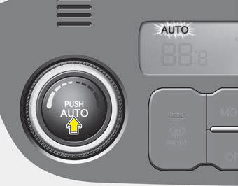
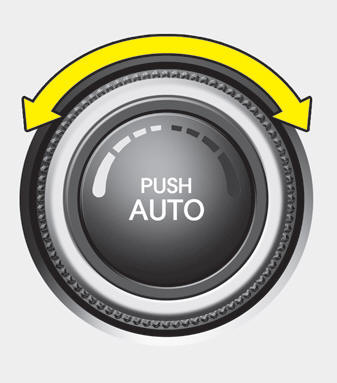
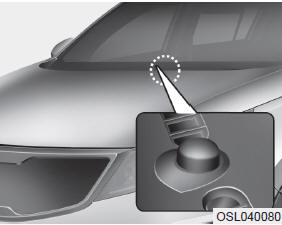

# Kia Sportage: Aquecimento automático e climatização

[Home](../../index.md) / [Manual do proprietário Kia Sportage SL](../sportage-1236.md) / [Características do seu veículo](sportage-1309.md) / [Sistema de controle de clima automático](sportage-1459.md) / Aquecimento automático e climatização

1. Pressione o botão AUTO.

Os modos, as velocidades do ventilador, a entrada de ar e a climatização serão controlados automaticamente de acordo com a configuração de temperatura.

2. Vire o botão de controle de temperatura para definir a temperatura desejada.

> **NOTA**
>
> - Para desligar a operação automática, selecione qualquer botão ou interruptor da seguinte lista:
>
>   - Botão de seleção de modo
>   - Botão de climatização
>   - Botão de desnebulização do para-brisa frontal (pressione o botão novamente para desseletar a função de desnebulização do para-brisa frontal. O sinal ‘AUTO’ iluminará novamente na tela de informações.)
>   - Interruptor de controle de velocidade do ventilador
>
> Enquanto a função selecionada for controlada manualmente, as outras funções continuarão a ser controladas automaticamente.
- Para sua conveniência e para melhorar a eficácia do controle de clima, use o botão AUTO e defina a temperatura em 23°C/73°F.

> **NOTA**
>
> Nunca coloque nada sobre o sensor localizado no painel para garantir um controle melhor do aquecimento e da refrigeração.
