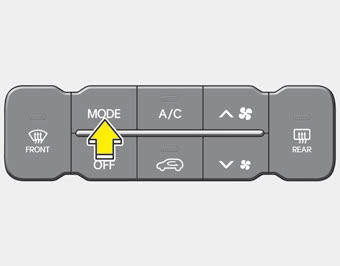
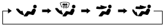
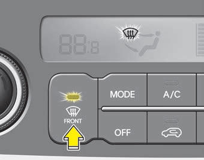
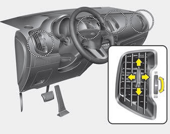

# Kia Sportage: Seleção de Modos

[Home](../../index.md) / [Manual do proprietário Kia Sportage SL](../sportage-1236.md) / [Características do seu veículo](sportage-1309.md) / [Sistema de controle climático manual](sportage-1459.md) / [Aquecimento e ar condicionado manual](sportage-1461.md) / Seleção de modos

O botão de seleção de modo controla a direção do fluxo de ar pelo sistema de
ventilação.

A saída de fluxo de ar é convertida conforme ilustrado:

Consulte a ilustração no “Sistema de controle climático manual”.

**Face-Level**

O fluxo de ar é direcionado para o corpo superior e o rosto. Além disso, cada
saída pode ser controlada para direcionar o ar expelido pela saída.

**Bi-Level**

O fluxo de ar é direcionado para o rosto e o chão.

**Floor-Level**

A maior parte do fluxo de ar é direcionada ao chão, com uma pequena quantidade
de ar sendo direcionada para o para-brisa e desentupidores das janelas laterais.

**Floor/Defrost-Level**

A maior parte do fluxo de ar é direcionada ao chão e ao para-brisa, com uma
pequena quantidade direcionada aos desentupidores das janelas laterais.

**Defrost-Level**

A maior parte do fluxo de ar é direcionada ao para-brisa, com uma pequena
quantidade de ar direcionada aos desentupidores das janelas laterais.

**Ventos do painel de instrumentos**

As saídas dos ventos podem ser abertas ou fechadas individualmente usando o
rolete do dedo. (Se equipado)

Também é possível ajustar a direção do fluxo de ar dessas saídas usando o
leviador de ventos conforme mostrado.
