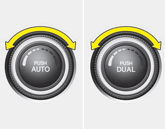
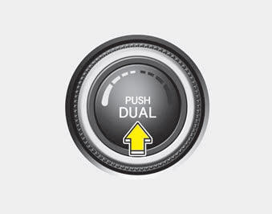

# Kia Sportage: Controle de Temperatura

[Home](../../index.md) / [Manual do proprietário Kia Sportage SL](../sportage-1236.md) / [Características do seu veículo](sportage-1309.md) / [Sistema de controle automático de clima](sportage-1459.md) / [Aquecimento e climatização manual](sportage-1461.md) / Controle de temperatura

A temperatura aumentará ao máximo (HI) girando o botão para a posição mais à direita.

A temperatura diminuirá ao mínimo (Lo) girando o botão para a posição mais à esquerda.

Ao girar o botão, a temperatura aumentará ou diminuirá em 0,5°C./1°F. Quando estiver no menor ajuste de temperatura, o ar condicionado funcionará continuamente.

**Ajustando a temperatura do lado do motorista e do passageiro individualmente**

1. Pressione o botão DUAL para operar a temperatura do lado do motorista e do passageiro individualmente. Também, se o controle de temperatura do lado do passageiro for operado, ele automaticamente mudará para o modo DUAL.

2. Operar o controle de temperatura à esquerda para ajustar a temperatura do lado do motorista. Operar o controle de temperatura à direita para ajustar a temperatura do lado do passageiro.

**Ajustando a temperatura do lado do motorista e do passageiro de forma igual**

1. Pressione o botão DUAL novamente para desativar o modo DUAL. A temperatura do lado do passageiro será definida para a mesma temperatura que o lado do motorista.

2. Operar o controle de temperatura do lado do motorista. A temperatura do lado do motorista e do passageiro será ajustada de forma igual.

**Conversão de temperatura**

Você pode trocar o modo de temperatura de Celsius para Fahrenheit da seguinte forma:

Pressionando o botão OFF, pressione o botão AUTO por 3 segundos ou mais.

A exibição mudará de Celsius para Fahrenheit, ou de Fahrenheit para Celsius.

Se a bateria estiver descarregada ou desconectada, o modo de exibição de temperatura será resetado para Celsius.
