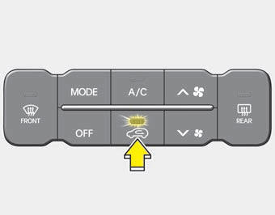
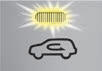
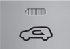

# Kia Sportage: Controle da entrada de ar

[Home](../../index.md) / [Manual do proprietário do Kia Sportage SL](../sportage-1236.md) / [Características do seu veículo](sportage-1309.md) / [Sistema de controle automático do clima](sportage-1459.md) / [Aquecimento e ar condicionado manual](sportage-1461.md) / Controle da entrada de ar

Isso é usado para selecionar a posição de ar externo (novo) ou ar recirculado.

Para alterar a posição do controle de entrada de ar, pressione o botão de controle.

**Posição de ar recirculado**

Com a posição de ar recirculado selecionada, o ar do compartimento do passageiro será
redirecionado para o sistema de aquecimento e aquecido ou resfriado de acordo com a função
selecionada.

**Posição de ar externo (novo)**

Com a posição de ar externo (novo) selecionada, o ar entra no veículo do exterior
e é aquecido ou resfriado de acordo com a função selecionada.

O uso prolongado do aquecedor na posição de ar recirculado (sem ar condicionado selecionado)
pode causar neblina no vidro e nas janelas laterais e o ar no compartimento do passageiro
pode ficar estagnado.

Além disso, o uso prolongado do ar condicionado na posição de ar recirculado
resultará em ar muito seco no compartimento do passageiro.

AVISO - Redução da Visibilidade

*O uso contínuo do sistema de controle do clima na posição de ar recirculado
pode permitir que a umidade aumente no veículo, o que pode causar neblina nos vidros e obscurecer
a visibilidade.*

AVISO - Ar Recirculado

*O uso contínuo do sistema de controle do clima na posição de ar recirculado
pode causar sonolência ou letargia, e perda do controle do veículo. Tente manter a posição
de entrada de ar na posição de ar externo (novo) o máximo possível ao dirigir.*
