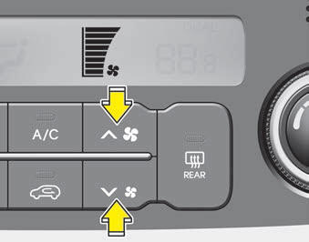

# Kia Sportage: Controle de velocidade do ventilador

[Início](../../index.md) / [Manual do proprietário do Kia Sportage SL](../sportage-1236.md) / [Características do seu veículo](sportage-1309.md) / [Sistema de controle automático de climatização](sportage-1459.md) / [Aquecimento e ar condicionado manual](sportage-1461.md) / Controle de velocidade do ventilador

A velocidade do ventilador pode ser ajustada para a velocidade desejada operando o interruptor de controle de velocidade do ventilador.

Para alterar a velocidade do ventilador, pressione (!

)
o interruptor para velocidade mais alta, ou empurre (!

)
o interruptor para velocidade mais baixa. Para desligar o controle de velocidade do ventilador, pressione o botão OFF do ventilador frontal.
