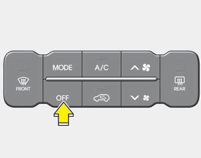

# Kia Sportage: Modo OFF

[Início](../../index.md) / [Manual do proprietário do Kia Sportage SL](../sportage-1236.md) / [Características do seu veículo](sportage-1309.md) / [Sistema de controle de climatização automático](sportage-1459.md) / [Aquecimento manual e ar condicionado](sportage-1461.md) / Modo OFF

Pressione o botão de desligamento do ventilador frontal OFF para desligar o sistema de climatização de ar do controle de clima frontal.
No entanto, você ainda pode operar os botões de modo e de entrada de ar desde que o interruptor de ignição esteja na posição ON.
