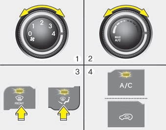

# Kia Sportage: Para desfogar o vidro-limpo

[Início](../../index.md) / [Manual do proprietário do Kia Sportage SL](../sportage-1236.md) / [Características do seu veículo](sportage-1309.md) / [Desfogamento e desnebulamento do vidro-dianteiro](sportage-1468.md) / [Sistema de controle climático manual](sportage-1469.md) / Para desfogar o vidro-dianteiro

1. Defina a velocidade do ventilador na posição desejada.

2. Selecione a temperatura desejada.

3. Selecione a

ou

posição.

4. O ar externo (fresco) será selecionado automaticamente. Se a posição

for selecionada, o ar condicionado também será selecionado automaticamente.

Se o ar condicionado e/ou a posição de ar externo (fresco) não forem selecionados automaticamente, pressione o botão correspondente manualmente.
