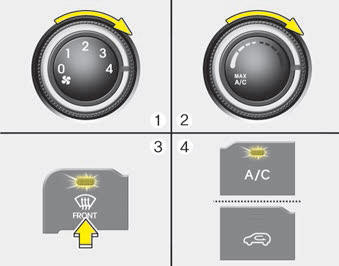

# Kia Sportage: Para desneblhar o vidro lateral externo

[Home](../../index.md) / [Manual do proprietário do Kia Sportage SL](../sportage-1236.md) / [Características do seu veículo](sportage-1309.md) / [Desneblie e defume o vidro](sportage-1468.md) / [Sistema de controle climático manual](sportage-1469.md) / Para desneblhar o vidro lateral externo

1. Defina a velocidade do ventilador na posição mais alta.

2. Defina a temperatura na posição mais quente.

3. Selecione a

posição.

4. O ar externo (limpo) e o ar condicionado serão selecionados automaticamente.

Se o ar condicionado não for selecionado automaticamente, pressione o botão correspondente manualmente.
