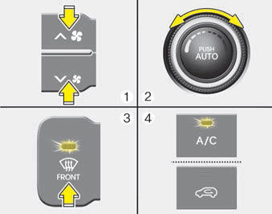
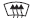

# Kia Sportage: Para desfogar o vidro-limpo

[Home](../../index.md) / [Manual do proprietário do Kia Sportage SL](../sportage-1236.md) / [Características do seu veículo](sportage-1309.md) / [Desfogamento e desnebulamento do para-brisa](sportage-1468.md) / [Sistema de controle climático automático](sportage-1472.md) / Para desfogar o vidro-limpo

1. Defina a velocidade do ventilador na posição desejada.

2. Selecione a temperatura desejada.

3. Pressione o botão de desnebulamento (

).

4. A posição de ar externo (novo) será selecionada automaticamente e o ar condicionado será ligado de acordo com a temperatura ambiente detectada.

Se a posição de ar condicionado e a posição de ar externo (novo) não forem selecionadas automaticamente, ajuste manualmente o botão correspondente. Se a

posição for selecionada, ajuste a velocidade do ventilador de baixa para alta.
