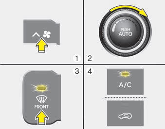

# Kia Sportage: Para desneblhar o vidro lateral externo

[Home](../../index.md) / [Manual do proprietário do Kia Sportage SL](../sportage-1236.md) / [Características do seu veículo](sportage-1309.md) / [Desnebliação e desembaçamento do vidro](sportage-1468.md) / [Sistema de controle climático automático](sportage-1472.md) / Para desneblhar o vidro lateral externo

1. Defina a velocidade do ventilador na posição mais alta.

2. Defina a temperatura na posição mais quente (HI).

3. Pressione o botão de desnebliação (!

).

4. A posição de ar externo (novo) será selecionada automaticamente e o ar
condicionado ligará conforme a temperatura ambiente detectada.
