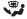

# Kia Sportage: Lógica de desfogamento

[Início](../../index.md) / [Manual do proprietário do Kia Sportage SL](../sportage-1236.md) / [Características do seu veículo](sportage-1309.md) / [Desembaçamento e desfogamento do para-brisa](sportage-1468.md) / Lógica de desfogamento

Para reduzir a possibilidade de formação de neblina no interior do para-brisa, o sistema de entrada de ar ou do ar condicionado é controlado automaticamente de acordo com certas condições, como

ou

posição. Para cancelar ou retornar à lógica de desfogamento, faça o seguinte.

- [Sistema manual de controle climático](sportage-1476.md)
- [Sistema automático de controle climático](sportage-1477.md)
