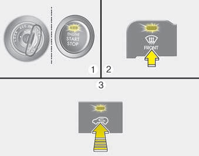

# Kia Sportage: Sistema de controle climático manual

[Home](../../index.md) / [Manual do proprietário do Kia Sportage SL](../sportage-1236.md) / [Características do seu veículo](sportage-1309.md) / [Desnebulamento e desneveamento do vidro frontal](sportage-1468.md) / [Lógica de desnebulamento](sportage-1475.md) / Sistema de controle climático manual

1. Coloque a chave do ignição na posição ON.

2. Gire o botão de seleção de modo para a posição de desnebulamento (!

).

3. Pressione o botão de controle de entrada de ar pelo menos 5 vezes dentro de 3 segundos.

A luz indicadora no botão de controle de entrada de ar piscará 3 vezes com
intervalo de 0,5 segundo. Isso indica que a lógica de desnebulamento foi cancelada ou retornada
ao status programado.

Se a bateria tiver sido descarregada ou desconectada, ela será resetada para o status da lógica de desnebulamento.
